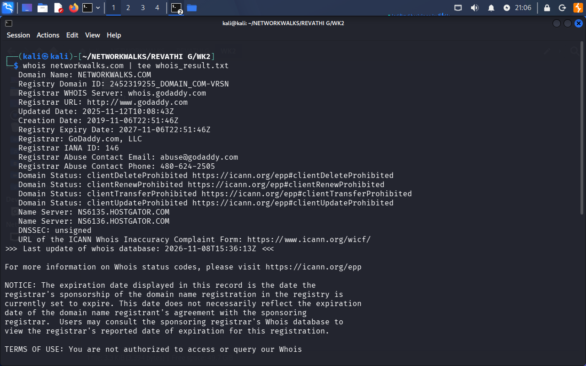
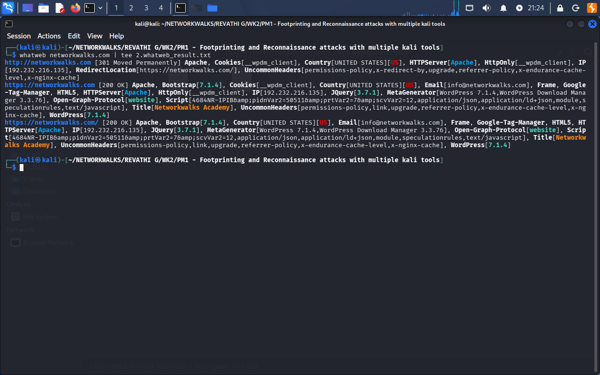
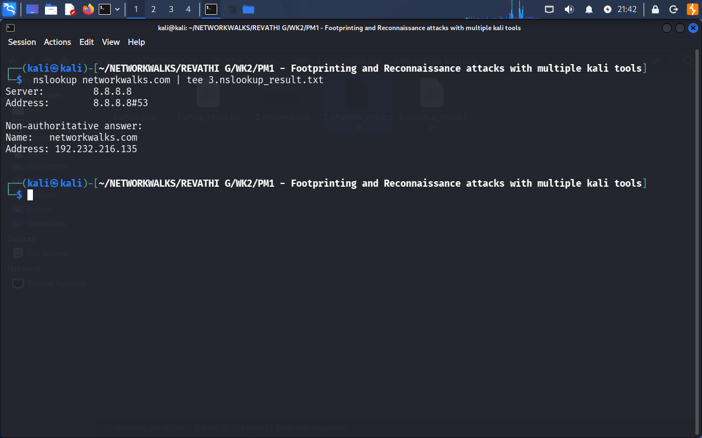
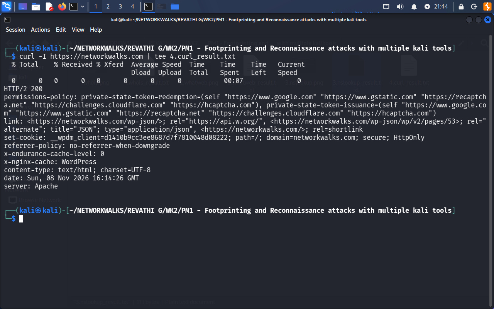
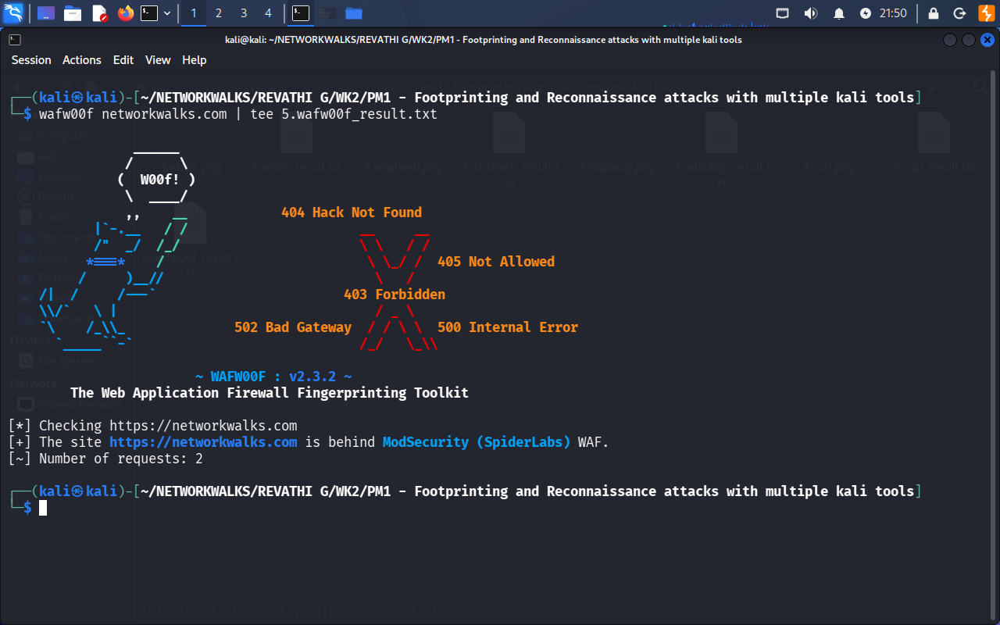
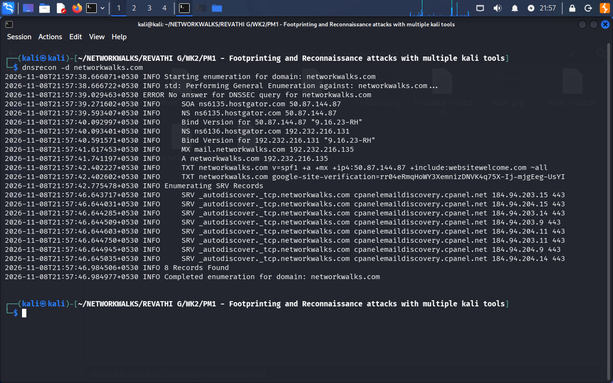
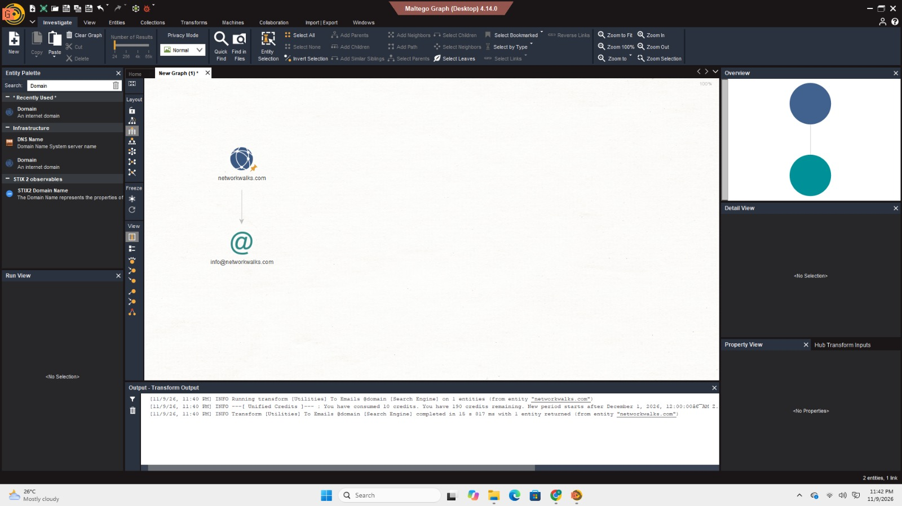

# WEEK 2 – FOOTPRINTING & RECONNAISSANCE REPORT

### Networkwalks Cybersecurity Internship

**Project:** Footprinting and Reconnaissance Using Multiple Kali Linux Tools & Network Scanning

---

## 1. Project Overview

This report documents my Week 2 practical activities as part of the Networkwalks Cybersecurity Internship.

The project focused on footprinting, reconnaissance, OSINT and network discovery using different cybersecurity tools.

I performed domain information gathering on `networkwalks.com` using Kali Linux tools and explored OSINT with theHarvester and Maltego. I also used Zenmap to discover active hosts on my local VirtualBox network.

The practical work helped me understand how information is collected and analysed before moving into further penetration testing activities.

## 2. Objectives

- Understand the footprinting and reconnaissance process.
- Collect domain registration information using WHOIS.
- Identify website technologies using WhatWeb.
- Perform DNS resolution and enumeration.
- Analyse HTTP response headers.
- Identify Web Application Firewall (WAF) technologies.
- Explore OSINT using theHarvester and Maltego.
- Discover active hosts using Zenmap.
- Understand the importance of reconnaissance in VAPT.

## 3. Tools Used

| Tool | Purpose |
|---|---|
| Kali Linux | Reconnaissance environment |
| WHOIS | Domain registration information |
| WhatWeb | Website technology identification |
| Nslookup | DNS lookup |
| cURL | HTTP response header analysis |
| Wafw00f | WAF detection |
| DNSRecon | DNS enumeration |
| theHarvester | OSINT information gathering |
| Maltego | Visual OSINT and relationship mapping |
| Zenmap | Network discovery and scanning |

## 4. Scope of Testing

| Category | Details |
|---|---|
| Program | Networkwalks Cybersecurity Internship |
| Project | Week 2 |
| Domain | networkwalks.com |
| Local network | 192.168.56.0/24 |
| Footprinting environment | Kali Linux |
| Network scanning tool | Zenmap |
| Network scanning environment | Windows / VirtualBox lab |

The domain footprinting activities were performed as part of the assigned internship exercise. The Zenmap scan was performed on my local lab network.

## 5. Practical Activities & Findings

### 5.1 WHOIS – Domain Information Gathering

**Command:**

```bash
whois networkwalks.com | tee whois_result.txt
```

WHOIS was used to gather publicly available registration information about the target domain.

**Information identified:**

- Domain registrar: GoDaddy.com, LLC
- Domain creation date
- Domain update date
- Domain registration status
- Name servers
- DNSSEC status

**Observation:**

WHOIS provided useful information about the domain registration and its associated name servers.

### 5.2 WhatWeb – Website Technology Identification

**Command:**

```bash
whatweb networkwalks.com | tee whatweb_result.txt
```

WhatWeb was used to identify the technologies and components used by the target website.

**Technologies identified:**

- Apache web server
- WordPress
- Bootstrap
- jQuery
- WordPress-related components

**Observation:**

The scan helped identify the website's technology stack and provided an initial understanding of its web environment.

### 5.3 Nslookup – DNS Resolution

**Command:**

```bash
nslookup networkwalks.com | tee nslookup_result.txt
```

Nslookup was used to resolve the domain name into its corresponding IP address.

**Result:**

```text
DNS Server: 8.8.8.8
Name: networkwalks.com
Address: 192.232.216.135
```

**Observation:**

The domain was successfully resolved using Google's public DNS server.

### 5.4 cURL – HTTP Response Header Analysis

**Command:**

```bash
curl -I https://networkwalks.com | tee curl_result.txt
```

The `-I` option was used to retrieve HTTP response headers without downloading the complete webpage.

**Information observed:**

| Header | Result |
|---|---|
| HTTP Status | HTTP/2 200 |
| Server | Apache |
| Content-Type | text/html; charset=UTF-8 |
| Set-Cookie | WordPress client cookie |
| X-Nginx-Cache | 0 |
| Link | WordPress REST API endpoint |

**Observation:**

The HTTP response headers provided information about the web server, content type, cookies and application-related endpoints.

This activity helped me understand how HTTP headers can provide useful technical information during web reconnaissance.

### 5.5 Wafw00f – Web Application Firewall Detection

**Command:**

```bash
wafw00f networkwalks.com | tee wafw00f_result.txt
```

Wafw00f was used to identify whether a Web Application Firewall was protecting the target website.

**Result:**

```text
The site https://networkwalks.com
is behind ModSecurity (SpiderLabs) WAF.
```

**Observation:**

The tool identified ModSecurity (SpiderLabs) as the WAF protecting the website.

This activity helped me understand the role of WAF detection during the reconnaissance phase.

### 5.6 DNSRecon – DNS Enumeration

**Command:**

```bash
dnsrecon -d networkwalks.com
```

DNSRecon was used to enumerate DNS records associated with the domain.

**Records and information observed:**

- NS records
- A records
- MX records
- TXT records
- SPF information
- SRV records

**Observation:**

DNSRecon reported 8 records and provided additional information about the domain's DNS infrastructure, mail services and service records.

### 5.7 theHarvester – OSINT Information Gathering

**Command 1:**

```bash
theHarvester -d microsoft.com -l 1000 -b baidu
```

I used theHarvester with Baidu as the selected source to explore publicly available information associated with the domain.

**Result:**

- No IP addresses found.
- No email addresses found.
- No people found.
- No hosts found.

**Observation:**

The selected source did not return any results for this search.

**Command 2:**

```bash
theHarvester -d microsoft.com -l 50 -b all
```

I also attempted to gather information using multiple available sources.

**Observation:**

Some sources could not complete their searches because the required API keys were missing or invalid.

This helped me understand that certain OSINT sources require API credentials for successful information gathering.

### 5.8 Maltego – Visual OSINT

**Target domain:**

```text
networkwalks.com
```

I used Maltego Desktop to explore relationships associated with the target domain.

**Activity performed:**

- Created a Domain entity.
- Added the target domain to the graph.
- Executed the To Emails transformation.
- Examined the returned email entity.

**Result:**

The transformation returned the following relationship:

```text
networkwalks.com
       |
       |
info@networkwalks.com
```

**Observation:**

Maltego helped me understand how OSINT information can be collected and represented visually through connected entities.

### 5.9 Zenmap – Network Discovery

**Target network:**

```text
192.168.56.0/24
```

**Command:**

```bash
nmap -sn 192.168.56.0/24
```

I selected the Ping Scan profile in Zenmap to discover active hosts on my local network.

**Result:**

```text
Nmap scan report for 192.168.56.1
Host is up.

Nmap done:
256 IP addresses scanned
1 host up
```

**Observation:**

The scan identified one active host in the scanned subnet.

**Discovered host:**

```text
192.168.56.1
```

This activity helped me understand how to identify live hosts within a network using Nmap through Zenmap.

### 5.10 Zenmap – Network Topology

After completing the network discovery scan, I opened the Topology tab in Zenmap.

**Activity performed:**

- Opened the Topology view.
- Examined the discovered host.
- Viewed the relationship between localhost and the discovered network host.

**Observation:**

The topology view displayed the discovered host `192.168.56.1` connected to localhost.

This provided a visual representation of the network discovery results.

## 6. Summary of Findings

| Tool | Key Finding |
|---|---|
| WHOIS | Domain registration and name server information |
| WhatWeb | Apache, WordPress and other web technologies |
| Nslookup | Resolved IP: 192.232.216.135 |
| cURL | HTTP/2 200 and response headers |
| Wafw00f | ModSecurity (SpiderLabs) detected |
| DNSRecon | 8 DNS records reported |
| theHarvester | Baidu returned no results; multiple sources had API-key limitations |
| Maltego | Domain-to-email relationship identified |
| Zenmap | 1 active host discovered |
| Zenmap Topology | Visual network topology generated |

## 7. Conclusion

During Week 2 of my Networkwalks Cybersecurity Internship, I gained practical experience in footprinting, reconnaissance, OSINT and network discovery.

I worked with multiple Kali Linux tools, including WHOIS, WhatWeb, Nslookup, cURL, Wafw00f and DNSRecon. I also explored theHarvester and Maltego to understand different approaches to collecting and analysing publicly available information.

Using Zenmap, I performed a Ping Scan on my local network and identified an active host. I also explored its topology view to understand how discovered hosts are represented visually.

Overall, this project strengthened my understanding of the reconnaissance phase and how information gathering supports the initial stages of Vulnerability Assessment and Penetration Testing (VAPT).

## 8. Evidences Collected

The following screenshots document the practical activities performed during this project. Each image represents the actual tool execution or its corresponding result.

### 8.1 WHOIS – Domain Information



### 8.2 WhatWeb – Technology Identification



### 8.3 Nslookup – DNS Resolution



### 8.4 cURL – HTTP Response Headers



### 8.5 Wafw00f – WAF Detection



### 8.6 DNSRecon – DNS Enumeration



### 8.7 theHarvester – Multiple Sources


### 8.8 theHarvester – Baidu Search


### 8.9 Maltego – Domain and Email Relationship



### 8.10 Zenmap – Network Scan Result


### 8.11 Zenmap – Network Topology


## 9. Disclaimer

This project was performed as part of cybersecurity learning and internship activities.

All scanning and testing should be conducted only on systems and networks for which proper authorization has been obtained. The findings documented here are intended for educational purposes.

---

**Project:** Week 2 – Footprinting and Reconnaissance  
**Program:** Networkwalks Cybersecurity Internship  
**Focus Area:** Vulnerability Assessment and Penetration Testing (VAPT)
